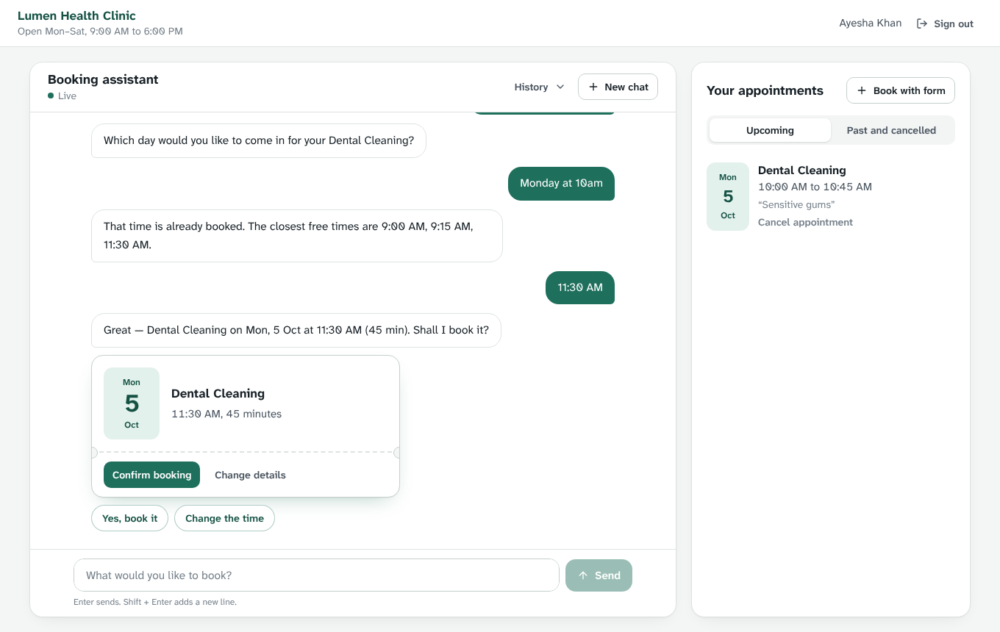
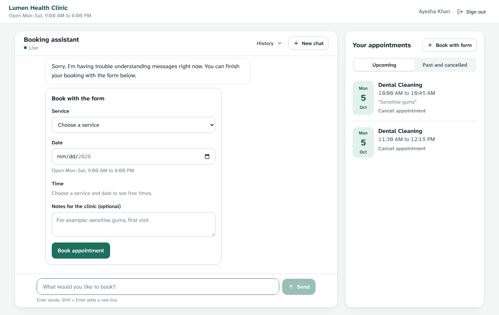

# Slotwise — Frontend (web app)

Next.js web app for **Slotwise**, an AI-assisted appointment booking product. Patients sign in,
chat with a booking assistant ("a dental cleaning Monday at 10am"), confirm a summary card, and
see their appointments update live — or book with a form that shows free time slots.

The API is a separate project: **slotwise-backend** (_add your repo link_). This app needs it running.

| | |
|---|---|
| **Live app** | _add your Vercel URL_ |
| **API** | _add your Render URL_ |
| **Demo login** | `demo@slotwise.dev` / `Demo@12345` (or create an account) |

| Conversational booking | AI unavailable → form fallback |
|---|---|
|  |  |

**Stack:** Next.js 16 (App Router) · React 19 · TypeScript · TanStack Query · Socket.IO client · Tailwind CSS 4 · lucide-react · sonner

---

## Quick start

**Prerequisites:** Node.js 20+, and the backend running (locally at `http://localhost:4000` or deployed).

```bash
cp .env.example .env.local      # set NEXT_PUBLIC_API_URL to the backend URL
npm install
npm run dev                     # → http://localhost:3000
```

Sign in with `demo@slotwise.dev` / `Demo@12345`.

| Command | What it does |
|---|---|
| `npm run dev` | Dev server on port 3000 |
| `npm run build` / `npm start` | Production build / serve it |
| `npm run typecheck` | TypeScript check |

**Docker:** `docker compose up --build` (or `docker build --build-arg NEXT_PUBLIC_API_URL=http://localhost:4000 -t slotwise-frontend .`).

## Environment variables

Copy `.env.example` to `.env.local`.

| Variable | Required | Example | Notes |
|---|---|---|---|
| `NEXT_PUBLIC_API_URL` | **yes** | `http://localhost:4000` · `https://slotwise-api.onrender.com` | Backend origin, **no trailing slash, no `/api/v1`**. Used for REST and the Socket.IO connection |
| `NEXT_PUBLIC_BUSINESS_SLUG` | no | `lumen-clinic` | Which business (tenant) this app books for. Default `lumen-clinic` (the seeded demo clinic) |

`NEXT_PUBLIC_*` values are inlined into the browser bundle **at build time** — after changing them on Vercel, redeploy.

The backend must allow this app's URL in its `CORS_ORIGINS`, otherwise the browser blocks every request.

## What's in the app

| Route | |
|---|---|
| `/login`, `/signup` | JWT auth with inline field errors; a demo-account shortcut on the login page |
| `/assistant` | The workspace: booking assistant (chat) + "Your appointments" panel; two tabs on mobile |

**Chat**
- Optimistic sending: your message appears immediately; failures show **Retry**, which re-sends with the same `clientMessageId` so the server can't duplicate it.
- Live updates over Socket.IO: assistant replies, a typing indicator, and changes made in other tabs. If the socket is down, replies still arrive in the HTTP response; after reconnecting the app refetches to catch up.
- Structured cards under assistant messages (`payload.action` from the API):
  - **Booking summary ticket** → *Confirm booking* (no AI call) or *Change details* (opens the form prefilled).
  - **Booked ticket**, **appointment list**, and the **inline booking form** the assistant falls back to when it can't help.
- Tappable suggested replies (real free times, next working days, services).
- Only the latest assistant message is interactive; older cards are read-only history.
- Conversation history menu and *New chat*.

**Appointments**
- Upcoming / past-and-cancelled tabs, cancel with inline confirmation.
- *Book with form*: service → date → free slots grouped into morning / afternoon / evening (fetched from the availability endpoint) → notes.
- If a prefilled or chosen time is no longer free, it's cleared with an explanation; a 409 from the server refreshes the slots.

**Times** are always shown in the clinic's timezone (from the API), not the browser's.

## How it's built

```
src/
  app/
    (auth)/login, (auth)/signup   sign-in screens (redirect away when already signed in)
    (portal)/assistant            main workspace (requires sign-in)
    providers.tsx                 QueryClient → AuthProvider → RealtimeProvider → Toaster
    error.tsx                     recoverable error screen
  features/
    chat/                         ChatPanel, MessageList, ActionView (cards), Composer, useChat
    appointments/                 AppointmentsPanel, BookingForm
  lib/
    api.ts                        typed fetch client, ApiError (field errors, alternatives)
    auth.tsx                      session state, token storage, 401 → sign out
    realtime.tsx                  Socket.IO → React Query cache
    chatCache.ts                  message/session upserts (dedupes HTTP + socket deliveries)
    format.ts                     dates/times in the business timezone
    types.ts                      API response types
  components/                     UI primitives, Ticket (date block), Modal (native <dialog>), route guards
```

**State.** Server state lives in TanStack Query. Components never touch the socket: `RealtimeProvider` writes pushed events into the query cache and components just read it. Messages from the HTTP response and from the socket are merged by id (and by `clientMessageId` for optimistic ones), so nothing appears twice.

**Defensive rendering.** Action payloads are stored JSON; anything malformed is skipped instead of crashing the conversation, and an error boundary offers a recovery screen.

**Accessibility.** Atkinson Hyperlegible Next (a typeface designed for legibility), labelled form controls with `aria-invalid`/`aria-describedby`, the conversation as `role="log"` so screen readers announce replies, visible keyboard focus, native `<dialog>` for the booking modal, and reduced-motion support.

**Design.** Cool "clinic paper" background, ink text, one clinic green for actions and the patient's own messages; amber for warnings, red only for destructive actions. The one bold element is the appointment "ticket" — a large date block with a perforated edge — reused for summaries, confirmations and the appointments list.

## Decisions and tradeoffs

- **Token in `localStorage` + `Authorization: Bearer`.** Works with the API on a different domain (Vercel ↔ Render) without cross-site cookies. Cost: readable by XSS. Production: httpOnly cookie on a shared parent domain or a Next.js backend-for-frontend.
- **Client-side route guards.** The token isn't visible to the server, so protected pages render a spinner until the session is restored, then redirect if needed.
- **REST for writes, socket for pushes**, matching the backend design.
- **No UI component library** — a small set of primitives keeps the bundle light and the look specific to this product.

## Known limitations

- No automated frontend tests yet (next: Playwright E2E for the booking flow, unit tests for `chatCache`).
- No refresh tokens — when the token expires, the user is signed out on the next request.
- English only; no dark mode.

## Deployment (Vercel)

1. Push this project to its own GitHub repository.
2. Vercel → **Add New → Project** → import the repo (framework: Next.js, root directory: `/`).
3. Environment variables: `NEXT_PUBLIC_API_URL=https://<your-api>.onrender.com` and optionally `NEXT_PUBLIC_BUSINESS_SLUG=lumen-clinic`.
4. Deploy, then add the Vercel URL to the backend's `CORS_ORIGINS` and restart the backend.

If the first sign-in is slow, the free Render API is waking up (30–50 s).
